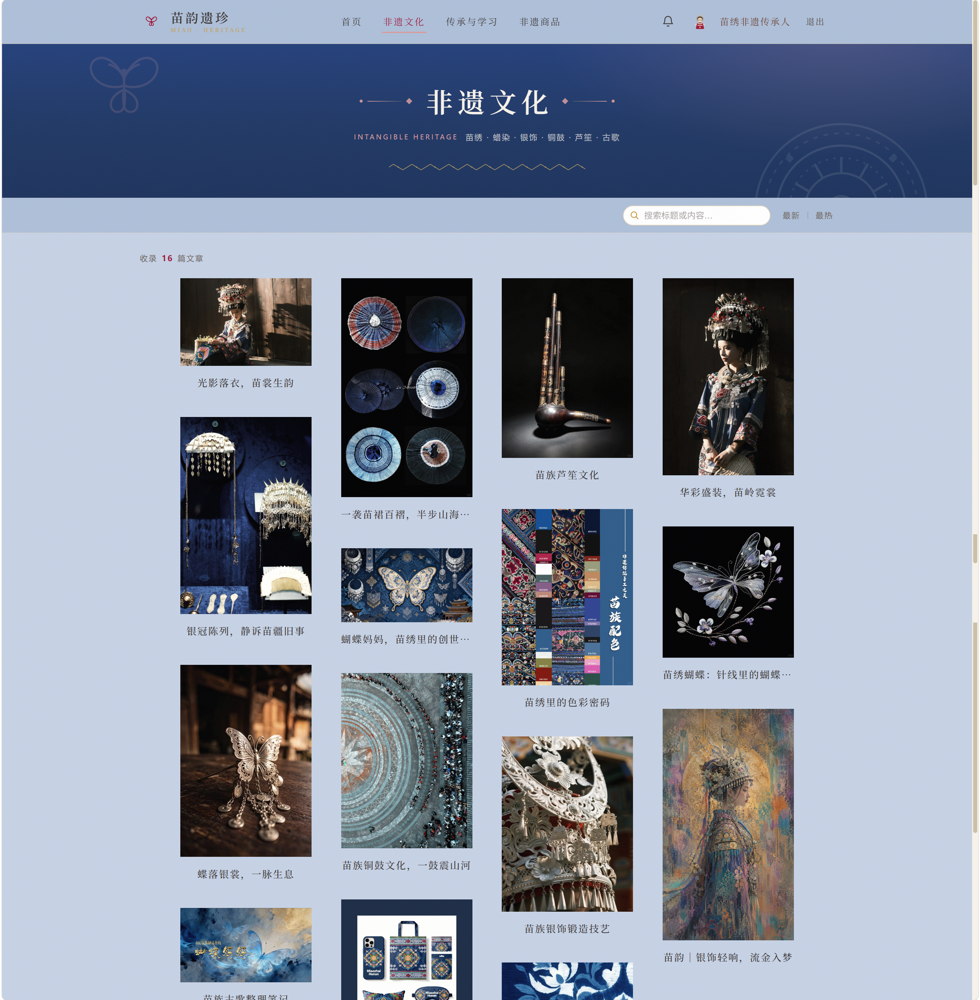
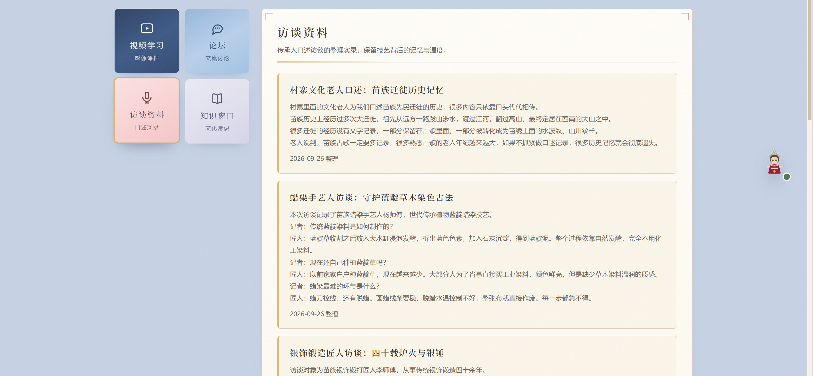
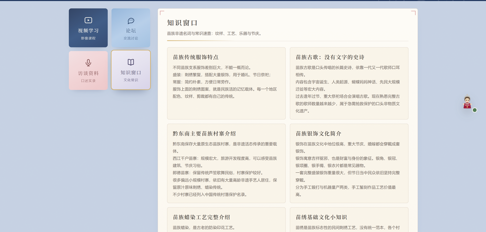
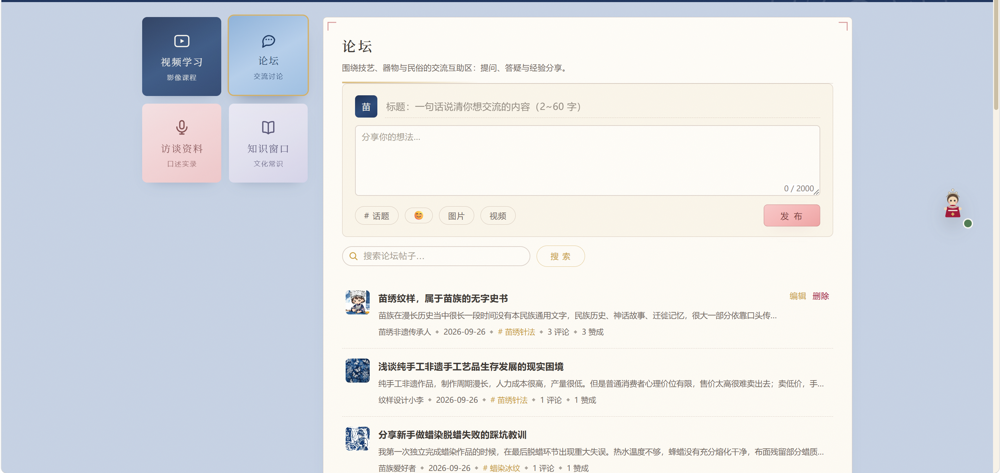
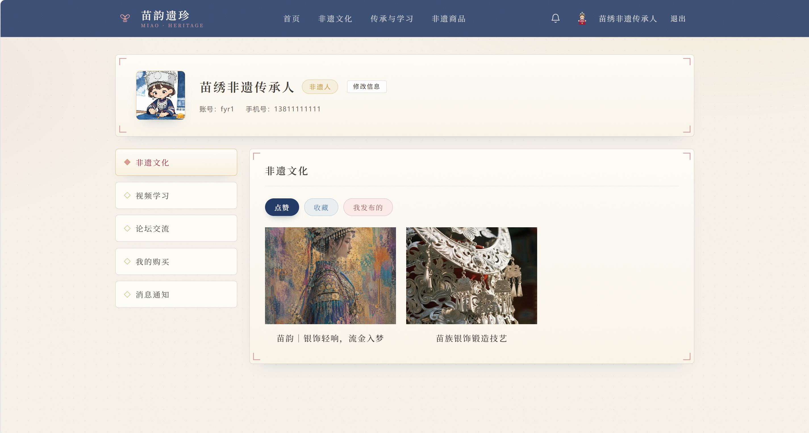
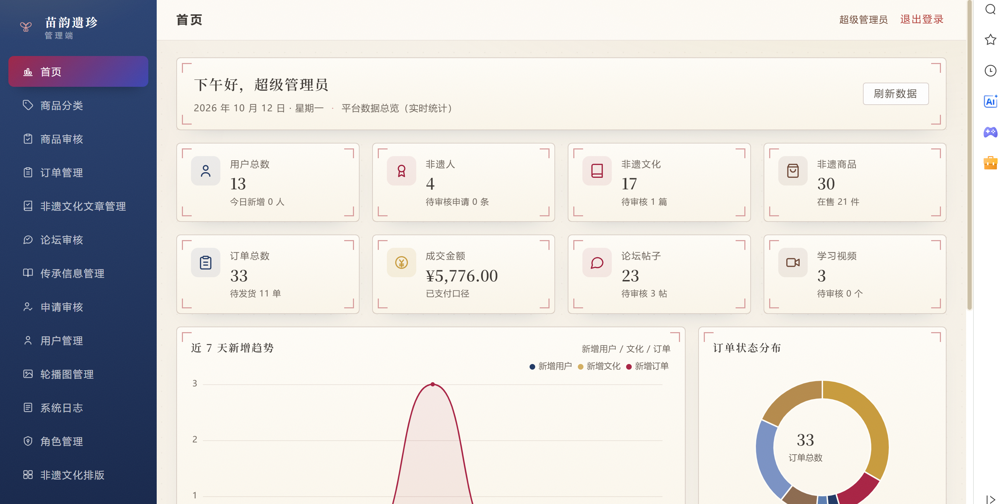
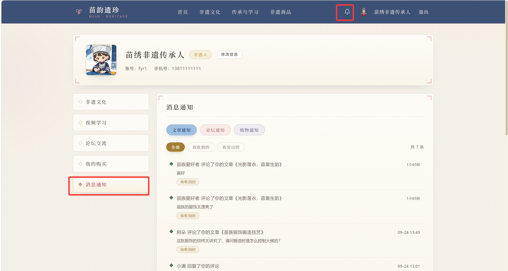
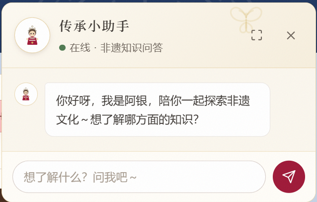
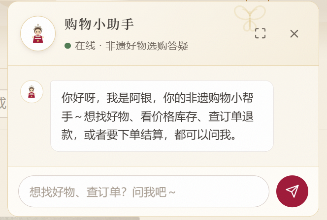

# Miao Intangible Heritage・苗韵遗珍

## 苗族非物质文化遗产数字化传承与保护平台

苗韵遗珍旨在解决苗族非遗传承人老龄化、文化传播渠道单一、年轻群体认知断层等问题。
以 数字化展示 + 非遗电商 + AI 智能助手 三位一体模式，搭建苗族非遗综合门户，
通过非遗手工艺品线上交易产生经济收益，反哺非遗文化传承，形成良性循环。

### ✨ 项目简介

平台包含三类用户：普通游客用户、非遗传承人、管理员（超级管理员、系统管理员、内容管理员、商城管理员/*sql脚本包含了不同管理员角色的功能描述，按照功能分配权限*/）

- 非遗文化展示：数字化收录苗绣、蜡染、银饰、芦笙古歌等苗族非遗资源，支持图文视频展示、点赞收藏、评论互动。精选图片文章、管理员进行排版
- 非遗电商交易：非遗传承人可上架手工艺品，支持购物车、分拆订单、模拟沙箱支付、订单状态流转、评价退款完整电商链路
- 技艺传承学习：传承人发布教学视频、口述访谈、非遗百科，配套社区论坛供爱好者交流学习
- AI 智能助手「阿银」：基于大模型的对话助手，支持非遗知识库问答，也可通过自然语言完成查商品、加购、下单、查订单等购物操作
- 后台管理系统：RBAC 细粒度权限、内容审核、数据可视化统计、系统日志、Banner 与资讯管理

### 🧩 系统角色

表格

| 角色 | 权限描述 |
| --- | --- |
| 普通用户 | 浏览非遗资料、点赞收藏、评论、购物下单、论坛发帖、AI 对话 |
| 非遗传承人 | 提交传承人资质申请；发布文化资料、教学视频、非遗商品；管理订单发货 |
| 管理员 | 内容审核、角色权限配置、数据统计、系统运营、AI 知识库维护 |

📦 业务模块

1. 非遗文化展示模块
  非遗资料发布 → 管理员审核 → 用户浏览，支持点赞、收藏、二级评论；支持后台自定义内容排序，优先展示优质非遗内容。

  
2. 非遗商品电商模块
  商品发布审核、购物车、收货地址管理。一次结算可按卖家自动拆分为多张订单，共用支付批次号；
  Redis 实现 3 分钟有效支付令牌，WebSocket 推送支付结果；定时任务自动取消超时未支付订单；
  订单全状态机流转，支持用户评价、追评，已支付未发货订单支持退款申请。下单保存商品快照，防止商品改价影响历史订单。

  
3. 传承学习模块
  非遗口述访谈、非遗知识百科、技艺教学视频（上传视频自动截取首帧生成封面）；
  记录用户观看记录；内置论坛社区，支持发帖、回复、点赞，供非遗爱好者交流。

  | 视频学习 | 访谈资料 |
  | --- | --- |
  |  |  |

  | 知识窗口 | 论坛交流 |
  | --- | --- |
  |  |  |
4. 用户与权限模块
  用户注册登录；传承人资质申请审核；RBAC 多角色权限管理；个人中心统一管理用户所有发布内容、订单、论坛帖子；首页轮播 Banner、系统公告、操作日志。

  | 用户个人中心 | 管理员权限 |
  | --- | --- |
  |  |  |
5. 站内通知模块
  统一消息推送，内容审核结果、订单状态变更等事件推送站内通知，AI 助手对话内也可接收通知提醒。

  
6. AI 智能助手模块（阿银）
  基于 LangChain4j 接入大模型，分为两大能力：
  - 非遗知识库问答：检索平台内真实非遗资料作答，杜绝 AI 幻觉；
  - 自然语言购物：对话方式完成商品检索、加购、下单、订单查询、退款申请等操作。

  | 学习助手 | 购物助手 |
  | --- | --- |
  |  |  |

### 🛠️ 技术架构

```
┌─────────────────────────────────┐
│   Vue 3 + Element Plus 前端      │
│   (用户前台 + 管理后台)          │
└───────────────┬─────────────────┘
                │
┌───────────────▼─────────────────┐
│   Spring Cloud Gateway 网关      │
│   JWT鉴权 / 路由转发 / 跨域处理  │
└───────────────┬─────────────────┘
        ┌───────┼────────┬────────┐
        ▼       ▼        ▼        ▼
mic-user    mic-culture mic-goods mic-inherit
用户权限    文化展示    商品电商   传承学习
        ▼
mic-notice（站内通知）
mic-agent（AI智能助手）
mic-file（OSS文件存储）
```

### 技术栈

- 后端：Java 21、SpringBoot3、SpringCloud  alibaba微服务、Nacos、OpenFeign、sentinel、MyBatis-Plus
- 中间件：MySQL、Redis、RabbitMQ、Elasticsearch
- AI：LangChain4j、LangGraph4j、DeepSeek 大模型、text-embedding-v4
- 前端：Vue3、Element Plus、ECharts、Pinia、Axios
- 存储：OSS 对象存储

### 💡 项目亮点

1. 全链路内容审核：传承人发布的商品、文化资料、教学视频、论坛帖子均需管理员审核后对外展示，保障内容合规。
2. 订单分拆与批次结算：一次购物结算，按不同卖家自动拆单，一次支付完成，各订单独立维护状态。
3. 沙箱模拟支付：Redis 生成限时支付令牌，WebSocket 实时推送支付结果，完整可演示的电商支付闭环。
4. 严格订单状态机：8 种订单状态约束流转规则，支持多路径退款申请。
5. AI 自然语言购物助手：纯对话完成购物全流程，AI 调用后端接口获取真实业务数据，不编造信息。
6. 非遗知识库问答：AI 检索平台内非遗资料回答，避免大模型幻觉。
7. 视频自动截帧：上传教学视频自动截取首帧生成封面图，简化传承人操作。
8. RBAC 细粒度权限：管理员可拆分内容审核、数据分析等独立角色，权限精细化管控。
9. 数据可视化大屏：ECharts 展示非遗内容发布趋势、商品销量、订单分布等运营数据。

🗄️ 数据库设计
项目一共设计 29 张数据表，覆盖用户权限、非遗文化、电商订单、传承学习、论坛、站内通知等业务域。
仓库根目录提供 mic.sql 数据库初始化脚本。

🚀 快速启动
前提：JDK21、Maven、MySQL8、Redis、Nacos、OSS 配置

1. 克隆项目
2. 导入数据库脚本
执行 mic.sql，初始化数据库表结构与基础数据。
3. 修改各微服务 application.yml 中数据库、Redis、Nacos 等连接地址，或通过下表环境变量注入凭证。
4. 启动 Nacos，依次启动各个微服务模块。
5. 启动 Vue 前端项目，访问前台与管理后台。

🔑 环境变量配置（仓库已脱敏，敏感凭证均从环境变量读取，不配置则使用适合本地演示的默认值）

| 环境变量 | 用途 | 默认值 |
| --- | --- | --- |
| MYSQL_USERNAME / MYSQL_PASSWORD | 各服务 MySQL 数据源 | root / 123456（本地演示库，请自行创建） |
| DEEPSEEK_API_KEY | mic-agent 对话模型（DeepSeek） | 无，AI 助手功能必填 |
| DASHSCOPE_API_KEY | mic-agent 向量模型（阿里云百炼，RAG 知识库） | 无，RAG 检索必填 |
| OSS_ENDPOINT / OSS_ACCESS_KEY_ID / OSS_ACCESS_KEY_SECRET / OSS_BUCKET_NAME | mic-file 阿里云 OSS 文件存储 | 无，文件上传必填 |
| ES_USERNAME / ES_PASSWORD | mic-agent Elasticsearch（ES 8.x 未开安全认证时留空） | elastic / 空 |
| RABBITMQ_USERNAME / RABBITMQ_PASSWORD | mic-goods / mic-notice 消息队列 | guest / guest |
| JWT_SECRET | 网关与各服务 JWT 签名密钥（mic.jwt.secret，所有服务须一致） | CHANGE_ME_MY_JWT_SECRET_KEY，生产务必替换 |
| NACOS_NAMESPACE | mic-notice 配置中心命名空间 | 空（public） |

设置方式：Linux/macOS `export DEEPSEEK_API_KEY=sk-xxx`；Windows PowerShell `$env:DEEPSEEK_API_KEY="sk-xxx"`；IDEA 在 Run Configuration 的 Environment variables 中填写。